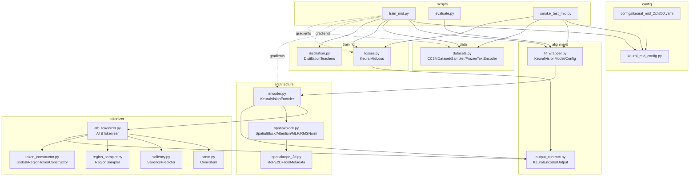
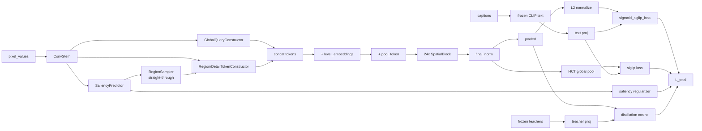

# Keural Mid-Level Vision Encoder — Complete Technical Specification

> **Status:** Reverse-engineered documentation of the current implementation.
> **Scope:** Every module in the training and evaluation pipeline.
> **Intent:** A from-scratch reimplementation reference for a new ML engineer.
> **Note:** This document describes *what the code does*. It does **not** judge correctness or propose fixes. Section 20 lists areas worth auditing later, factually.

---

## Table of Contents

1. [Repository Overview](#1-repository-overview)
2. [Model Architecture](#2-model-architecture)
3. [Forward Pass](#3-forward-pass)
4. [Text Pipeline](#4-text-pipeline)
5. [Training Pipeline](#5-training-pipeline)
6. [Contrastive Learning](#6-contrastive-learning)
7. [Distillation Pipeline](#7-distillation-pipeline)
8. [Saliency Learning](#8-saliency-learning)
9. [Tokenization Pipeline](#9-tokenization-pipeline)
10. [HCT (Hierarchical Concept Tokens)](#10-hct-hierarchical-concept-tokens)
11. [Loss Function](#11-loss-function)
12. [Data Pipeline](#12-data-pipeline)
13. [Evaluation Pipeline](#13-evaluation-pipeline)
14. [Checkpointing](#14-checkpointing)
15. [Distributed Training](#15-distributed-training)
16. [Configuration](#16-configuration)
17. [Tensor Shape Reference](#17-tensor-shape-reference)
18. [Computational Graph](#18-computational-graph)
19. [Complete Execution Timeline](#19-complete-execution-timeline)
20. [Potential Areas for Future Audit](#20-potential-areas-for-future-audit)

---

## 1. Repository Overview

### 1.1 Project Goal

The **Keural Mid-Level Vision Encoder** ("keural-mid") is a ~183.5M-parameter vision encoder that produces a single pooled image embedding (768-dim) aligned to a text embedding space, trained by a combination of:

- **Sigmoid contrastive (SigLIP-style) image↔text alignment**
- **Hierarchical Concept Token (HCT) global↔text alignment**
- **Saliency-map regularization** (anti-collapse + smoothness)
- **Knowledge distillation** from two frozen teachers (SigLIP-SO400M and InternViT-300M)

Its distinguishing feature is the **Adaptive Token Budget (ATB) tokenizer**: instead of a fixed patch grid, it predicts a saliency map and allocates a token budget across three hierarchy levels — **GLOBAL**, **REGION**, **DETAIL** — using a differentiable Gumbel-Top-K sampler with a warmup curriculum.

### 1.2 Architecture (high level)

```
RGB image (B,3,H,W)
   │
   ▼
ATB Tokenizer  ──► hierarchical tokens (B,N,768) + level_ids + spatial_metadata + saliency_map
   │
   ▼
+ level embeddings   (per-token learned bias by level)
   │
   ▼
prepend [POOL] token  ──► (B, N+1, 768)
   │
   ▼
24× SpatialBlock  (RMSNorm → 2D-RoPE attention + scale-bias → SwiGLU MLP, pre-norm residuals)
   │
   ▼
final RMSNorm
   │
   ▼
split:  pooled = x[:,0]  (B,768)   ;   tokens = x[:,1:]  (B,N,768)
   │
   ▼
KeuralEncoderOutput
```

> **Note on "projection head":** The audit checklist refers to a `pool_token_projection Linear(768→768)`. In the current code there is **no separate Linear projection head** on the image side. The pooled embedding is `x[:,0]` after `final_norm` — the `[POOL]` token's output. The 768→768 "projection" effect is achieved by the `[POOL]` token attending through the 24 transformer blocks. The only explicit projection `Linear` layers are: the **text projection** (`FrozenTextEncoder.proj`) and the **teacher projections** (`siglip_proj`, `internvit_proj`) inside `KeuralMidLoss`.

### 1.3 Training Stages

There is a single training run (no multi-phase pretrain/finetune), but the tokenizer follows an internal **curriculum** keyed on the global `step`:

| Phase | Step range | Tokenizer behavior |
|-------|-----------|--------------------|
| **Warmup (fixed grid)** | `step < warmup_steps_fixed_grid` (10000) | Region/detail picks use `deterministic_grid_regions` (uniform grid); no Gumbel noise. |
| **Adaptive (annealed)** | `step ≥ 10000` | Learned `RegionSampler` with Gumbel-Top-K; Gumbel temperature anneals linearly `1.0 → 0.05` over `temperature_anneal_steps` (50000). |
| **Eval** | `step = None` | No Gumbel noise (deterministic argmax top-K). |

In the `2xh200` config, `max_steps = 18000`, so adaptive tokenization is active for steps 10000–18000 and temperature anneals only partway (8000/50000 of the schedule).

### 1.4 Inference Pipeline

`KeuralVisionModel.from_pretrained(ckpt)` → `model(pixel_values)` → `KeuralEncoderOutput.pooled` (B,768) → L2-normalize → use as image embedding.

### 1.5 Evaluation Pipeline

`scripts/evaluate.py` runs three benchmarks:
- **ImageNet zero-shot** (1000-class, 5 prompt templates, raw frozen CLIP text encoder)
- **Flickr30k retrieval** (image↔text, R@1/5/10)
- **CIFAR-100 linear probe** (frozen features + trained `Linear(768→100)`, 100 epochs SGD)

### 1.6 File Dependency Graph



---

## 2. Model Architecture

All shapes use **B** = batch, **D** = `embed_dim` = 768, **N** = total token count (`K_g + K_r + K_d`), **h** = H/16, **w** = W/16.

### 2.1 CNN Stem — `ConvStem`

- **File:** `tokenizer/stem.py:38-126`
- **Purpose:** Downsample RGB to a 1/16-resolution 768-channel feature grid.
- **Constructor:** `ConvStem(config: StemConfig, in_channels=3)`
- **Layers:** 4 sequential `[Conv2d(k=3, stride=2, pad=1) → GroupNorm(min(8,C), C) → GELU]` blocks with channel progression `3 → 128 → 256 → 512 → 768`. Cumulative stride = 16.
- **forward:** `(B,3,H,W) → (B,768,H/16,W/16)`. Requires H,W multiples of 16.
- **Trainable params:** 4× Conv2d weights `(128,3,3,3)`,`(256,128,3,3)`,`(512,256,3,3)`,`(768,512,3,3)` + GroupNorm weight/bias per layer.
- **Helper:** `pad_to_stride(pixel_values, stride=16)` right/bottom-pads arbitrary resolutions to a stride multiple.

### 2.2 Saliency Predictor — `SaliencyPredictor`

- **File:** `tokenizer/saliency.py:26-117`
- **Purpose:** Per-position saliency map in (0,1), **sigmoid** (not softmax) so multiple regions can be salient.
- **Constructor:** `SaliencyPredictor(config: SaliencyConfig, in_channels=768)`
- **Layers:** `conv_hidden: Conv2d(768→192, k=3, pad=1)` → GELU → `conv_score: Conv2d(192→1, k=1)` → sigmoid. `conv_score` init: weight `trunc_normal(std=0.01)`, bias 0 ⇒ sigmoid(0)≈0.5 initially.
- **forward:** `(B,768,h,w) [, valid_mask] → (B,1,h,w)`; masked positions forced to 0.

### 2.3 Adaptive Token Budget — `split_budget` + `ATBTokenizer`

- **File:** `tokenizer/atb_tokenizer.py:84-118` (`split_budget`), `:120-351` (`ATBTokenizer`)
- **`split_budget(token_budget, split, floors) → (K_g, K_r, K_d)`**: allocates the budget by ratio with floors. For budget=512, `split={0.05,0.25,0.70}`, `floors={8,16,0}`: `K_g=26, K_r=128, K_d=358`.
- See [§9](#9-tokenization-pipeline) for the full tokenizer forward.

### 2.4 Hierarchical Concept Tokenization — token constructors

- **File:** `tokenizer/token_constructor.py`
- **`GlobalQueryConstructor` (`:32-168`)**: a learned query pool `queries (max_global_tokens, 768)` cross-attends (Perceiver-style) to flattened stem features. `q_proj/k_proj/v_proj/out_proj` `Linear(768→768)`, `out_norm: LayerNorm(768)`. forward: `(B,768,h,w), K_g → (B,K_g,768)`. `max_global_tokens = max(8, ceil(2048*0.05)) = 103`.
- **`RegionTokenConstructor` (`:170-242`)**: differentiable weighted pooling using region soft-weights, then `[LayerNorm → Linear(768→1536) → GELU → Linear(1536→768)]` MLP with residual + `out_norm`. forward: `(B,768,h,w), SampledRegions → (B,K,768)`. **Two separate instances** (region & detail) with independent weights.
- Metadata helpers: `compute_spatial_metadata(coords, h, w, receptive_field) → (B,K,4)` (cx,cy,w,h ∈ [0,1]); `global_token_metadata(...) → (B,K_g,4)` filled `[0.5,0.5,1.0,1.0]`.

### 2.5 Transformer — `SpatialBlock` ×24

- **File:** `architecture/spatial/block.py`
- **`RMSNorm(dim, eps=1e-6)` (`:27-46`)**: fp32 RMS normalize × learned `weight (dim,)`.
- **`SwiGLUMLP(embed_dim, mlp_ratio=4)` (`:49-69`)**: `w_down(silu(w_gate(x)) * w_up(x))`, hidden = round-to-64 of `embed_dim*mlp_ratio*2/3` (≈2048). All `bias=False`.
- **`SpatialAttention(embed_dim, num_heads, head_dim, rope_base=10000, num_scale_buckets=8)` (`:72-172`)**:
  - `q_proj/k_proj/v_proj/out_proj`: `Linear(768→768, bias=False)`.
  - `scale_bias: nn.Parameter(num_scale_buckets=8, 768)` — added to the **query input** via `compute_scale_bias` (log-area bucketed) so same-location tokens at different scales differ.
  - 2D-RoPE applied to Q,K via `RoPE2DFromMetadata`.
  - SDPA with optional padding mask. (Within the encoder, all N+1 tokens are real, so the mask is all-ones.)
- **`SpatialBlock(config)` (`:175-200`)**: pre-norm residuals `x = x + attn(norm1(x), meta, mask); x = x + mlp(norm2(x))`.

### 2.6 2D RoPE — `RoPE2DFromMetadata`

- **File:** `architecture/spatial/rope_2d.py:30-177`
- `head_dim` split in half: first half rotated by `cx`, second half by `cy` (both ×`pos_scale=100`). `inv_freq` buffer; no trainable params. `compute_scale_bias` (`:180-213`) buckets `log(w*h)` into `num_scale_buckets` and indexes a learned embedding.

### 2.7 Pool Token, Level Embeddings, Output — `KeuralVisionEncoder`

- **File:** `architecture/encoder.py:33-245`
- **Trainable params:**
  - `level_embeddings: nn.Parameter(NUM_LEVELS=3, 768)` — added per token by `level_ids`.
  - `pool_token: nn.Parameter(1,1,768)` — prepended `[POOL]` token.
  - `pool_metadata`: **buffer** `(1,4)` = `[0.5,0.5,1.0,1.0]` (not trainable).
  - `blocks`: 24× `SpatialBlock`.
  - `final_norm`: `RMSNorm(768)`.
  - `tokenizer`: `ATBTokenizer`.
- **`pooled` is `final_norm(x)[:,0]`** — the `[POOL]` token output. No extra Linear head.

### 2.8 Output Contract — `KeuralEncoderOutput`

- **File:** `alignment/output_contract.py:48-281`. Dataclass fields:

| Field | Shape | Dtype | Meaning |
|-------|-------|-------|---------|
| `tokens` | (B,N,D) | float | per-token embeddings (padding=0) |
| `attention_mask` | (B,N) | int64 | 1=real, 0=pad |
| `level_ids` | (B,N) | int64 | 0/1/2; pad=-1 |
| `spatial_metadata` | (B,N,4) | float | (cx,cy,w,h)∈[0,1] |
| `saliency_scores` | (B,N) | float | per-token confidence |
| `pooled` | (B,D) | float | **the image embedding** |
| `token_budget_used` | (B,) | int64 | budget per item |

Constants: `LEVEL_GLOBAL=0, LEVEL_REGION=1, LEVEL_DETAIL=2, NUM_LEVELS=3`. Methods: `num_real_tokens`, `get_level_mask`, `get_tokens_for_level`, `to`, `detach`, `validate`. Factory `empty_output(...)`.

### 2.9 HF Wrapper — `KeuralVisionModel` / `KeuralVisionConfig`

- **File:** `alignment/hf_wrapper.py:52-198`
- `KeuralVisionConfig(model_type="keural_vision")` wraps a `KeuralConfig` (nested under key `keural_config`), mirroring `embed_dim/depth/num_heads/...` at top level.
- `KeuralVisionModel(PreTrainedModel)`: `base_model_prefix="keural"`, holds `self.encoder = KeuralVisionEncoder`. `save_pretrained` writes `config.json` + `pytorch_model.bin` with keys `encoder.*`. `from_pretrained` reconstructs config and loads weights.

---

## 3. Forward Pass

End-to-end, `KeuralVisionEncoder.forward(pixel_values, token_budget=None, valid_mask=None, step=None, return_saliency_map=False)`:

```
pixel_values                                            (B, 3, H, W)
        │  token_budget = _resolve_default_budget(...) if None
        ▼
ATBTokenizer(pixel_values, token_budget, valid_mask, step)
   ├─ ConvStem                          (B,3,H,W)   → (B,768,h,w)
   ├─ SaliencyPredictor                 (B,768,h,w) → (B,1,h,w)
   ├─ split_budget                      → (K_g,K_r,K_d)
   ├─ GlobalQueryConstructor            → global_tokens (B,K_g,768)
   ├─ region/detail sampling            → SampledRegions (coords,scores,soft_weights)
   ├─ Region/DetailTokenConstructor     → region_tokens (B,K_r,768), detail_tokens (B,K_d,768)
   └─ concat                            → tokens (B,N,768), level_ids (B,N),
                                           spatial_metadata (B,N,4), saliency_scores (B,N)
        │
        ▼
x = tokens + level_embeddings[level_ids]                (B, N, 768)
        │
        ▼
prepend pool_token; prepend pool_metadata               x:(B, N+1, 768)
                                                         full_metadata:(B, N+1, 4)
block_attn_mask = ones(B, N+1)                          (all tokens real)
        │
        ▼
for blk in blocks (×24):
    x = blk(x, full_metadata, block_attn_mask)          (B, N+1, 768)
        │
        ▼
x = final_norm(x)                                        (B, N+1, 768)
        │
        ├─ pooled     = x[:, 0]                          (B, 768)   ← image embedding
        └─ seq_tokens = x[:, 1:]                         (B, N, 768)
        │
        ▼
KeuralEncoderOutput(tokens=(B,N,768), pooled=(B,768),
                    level_ids, spatial_metadata, saliency_scores,
                    attention_mask=ones(B,N), token_budget_used=(B,))
   (+ saliency_map (B,1,h,w) if return_saliency_map)
```

`_resolve_default_budget`: returns `default_token_budget` if `H*W ≤ 256²`, else `min(max_token_budget, round(H*W/256² * default_token_budget))`.

---

## 4. Text Pipeline

- **File:** `data/datasets.py:556-643` (`FrozenTextEncoder`)

```
captions: list[str]  (len B)
        │
        ▼  CLIPTokenizer(padding=True, truncation=True, max_length=77)
input_ids / attention_mask
        │
        ▼  CLIPTextModel  (FROZEN — requires_grad_(False))
pooler_output  (EOS-token embedding)                    (B, 768)
        │
        ▼  self.proj : nn.Linear(raw_dim=768 → output_dim=768)   ← TRAINABLE
text_embeds                                             (B, 768)
```

- **Backends (in order):** CLIP (`CLIPTextModel`/`CLIPTokenizer`) → sentence-transformers → SHA256 hash fallback (128-dim) for smoke tests.
- **Trainable:** only `proj`. The backbone is frozen.
- **Normalization:** `forward` returns `proj(pooler_output)` **without** L2 norm. L2 normalization happens later inside `KeuralMidLoss.forward` (`F.normalize(text_embeds, dim=-1)`).
- Returned as `self.proj(raw.clone())`.

---

## 5. Training Pipeline

- **File:** `scripts/train_mid.py:167-415` (`train`), helpers `:59-164`.

### 5.1 Components built per run
- **Student:** `KeuralVisionModel` (wrapped in DDP if distributed; `raw_model` is the unwrapped module).
- **Loss module:** `KeuralMidLoss(config.loss, siglip_embed_dim, internvit_embed_dim, embed_dim=768)` — owns `logit_scale`, `logit_bias`, `siglip_proj`, `internvit_proj`.
- **Text encoder:** `FrozenTextEncoder` — frozen backbone + trainable `proj`.
- **Teachers:** `DistillationTeachers` — frozen SigLIP + InternViT (eval mode, no grad).

### 5.2 Optimizer
- `AdamW`, `lr=config.training.lr` (5e-4), `betas=(0.9,0.95)`, `weight_decay=0.05`.
- **Param group 1:** `model.parameters() + loss_fn.parameters()`.
- **Param group 2:** trainable `text_encoder` params (the `proj`), added via `add_param_group` with the **same lr**.

### 5.3 Scheduler
- `cosine_warmup_lr(step, peak_lr, warmup_steps, max_steps, min_lr_ratio=0.05)`: linear warmup for `step < warmup_steps` (2000), then cosine decay to `0.05*peak_lr`. Applied by overwriting every param group's `lr` each step.

### 5.4 AMP / precision
- `use_amp = precision∈{bf16,fp16} and cuda`. `amp_dtype = bf16` or `fp16`.
- `GradScaler` created **only** for fp16 (`needs_scaler`); bf16 runs without a scaler.

### 5.5 Gradient accumulation
- `gradient_accumulation` (config: 2). Loss is scaled by `1/gradient_accumulation` before `backward`. Optimizer steps every `gradient_accumulation` micro-batches.

### 5.6 Gradient clipping
- `clip_grad_norm_(model params, max_norm=1.0)` before `optimizer.step()` (after `scaler.unscale_` when fp16).

### 5.7 DDP
- `setup_ddp()`: `init_process_group(backend="nccl")` if `RANK` env set; `set_device(local_rank)`. DDP wrap with `find_unused_parameters=False`. Per-rank seed `seed + rank`.

### 5.8 Checkpointing
- Every `save_every` (config: 1000) steps, **rank 0** writes `checkpoint-{step}/`:
  - `raw_model.save_pretrained(ckpt_dir)` → vision encoder weights + `config.json`.
  - `_save_training_state` → `training_state.pt` (`step`, `optimizer.state_dict()`, optional `scaler`).
- Final model → `final/`. Full per-step logs → `training_log.jsonl`.

### 5.9 Per-iteration sequence
See [§19](#19-complete-execution-timeline) for the full step-by-step trace.

---

## 6. Contrastive Learning

- **File:** `training/losses.py:37-50` (`sigmoid_siglip_loss`), `:151-221` (`KeuralMidLoss.forward`).

### 6.1 Embedding generation
- **Image:** `image_embeds = F.normalize(encoder_output.pooled, dim=-1)` → (B,768).
- **Text:** `text_normed = F.normalize(text_embeds, dim=-1)` → (B,768). (`text_embeds` is `FrozenTextEncoder.proj(pooler_output)`.)

### 6.2 SigLIP sigmoid loss

```
similarity = image_embeds @ text_embeds.Tᵀ              (B, B)
logits     = similarity · exp(logit_scale) + logit_bias (B, B)
targets    = -1 everywhere, +1 on diagonal              (B, B)
loss       = softplus(-targets ⊙ logits)                (B, B)
L_primary  = Σ loss / B                                 (scalar)
```

Equivalently, with `t = exp(logit_scale)` (learnable temperature) and `b = logit_bias` (learnable bias):

$$\mathcal{L}_{\text{siglip}} = \frac{1}{B}\sum_{i=1}^{B}\sum_{j=1}^{B}\log\!\left(1 + e^{-y_{ij}\,(t\,\langle \hat{I}_i,\hat{T}_j\rangle + b)}\right),\quad y_{ij}=\begin{cases}+1 & i=j\\ -1 & i\ne j\end{cases}$$

- **Positive pairs:** the diagonal (image i ↔ caption i).
- **Negative pairs:** all off-diagonal entries (image i ↔ caption j≠i) within the **local batch**.
- **Reduction:** sum over all B² entries, divide by B (SigLIP convention).
- **Distributed:** there is **no** `all_gather` of embeddings — the similarity matrix is computed over the local per-GPU batch only (see [§15](#15-distributed-training) and [§20](#20-potential-areas-for-future-audit)).

### 6.3 Temperature & bias
- `logit_scale = nn.Parameter(learnable_temperature_init=2.30)`; used as `exp(logit_scale)` ≈ 9.97 at init.
- `logit_bias = nn.Parameter(learnable_bias_init=-10.0)`.
- Both live in `KeuralMidLoss` and are used by both `L_primary` and `L_hct`.

---

## 7. Distillation Pipeline

- **Files:** `training/distillation.py` (teachers), `training/losses.py:83-117` (`distillation_loss`).

### 7.1 Teachers
- **`SigLIPTeacher` (`:24-43`):** `SiglipVisionModel` (frozen, eval). forward(`(B,3,H,W)`) → `pooler_output` (B,**1152**). `@torch.no_grad()`.
- **`InternViTTeacher` (`:46-73`):** `AutoModel(trust_remote_code=True)`, cast to **bfloat16**. Resizes input to **448×448** (bicubic) if needed. forward → `last_hidden_state[:,0]` (CLS), cast to float32 → (B, **768**) per code (`last_hidden_state[:,0]`). `@torch.no_grad()`.
- **`DistillationTeachers` (`:76-150`):** lazy loads both with graceful fallback (training continues if one fails; raises only if **both** fail). forward → `(siglip_pooled | None, internvit_pooled | None)`.

> **Dimension note:** `SigLIPTeacher` returns 1152-dim. For InternViT the code reads the CLS token of `last_hidden_state` (768-dim per `distillation.py`), while the `2xh200.yaml` sets `internvit_embed_dim: 1024` and `KeuralMidLoss`'s default is also 1024; `DistillationConfig`'s dataclass default is 768. The `internvit_proj` Linear is sized from the value passed into `KeuralMidLoss` (`internvit_embed_dim`). This dim disagreement is recorded factually in [§20](#20-potential-areas-for-future-audit).

### 7.2 Projection + cosine loss
- In `KeuralMidLoss.forward`: `siglip_proj(teacher_siglip_pooled)` and `internvit_proj(teacher_internvit_pooled)` map teachers to 768-dim. Projections are `Linear(D_teacher→768, bias=False)` (or `Identity` if dims match) and are **trainable**.
- `distillation_loss(keural_pooled, teacher_siglip, teacher_internvit, λ_siglip, λ_internvit)`:

$$\mathcal{L}_{\text{distill}} = \lambda_{\text{sig}}\big(1 - \cos(\hat{p}, \hat{s})\big) + \lambda_{\text{int}}\big(1 - \cos(\hat{p}, \hat{v})\big)$$

where `p=keural_pooled`, `s=siglip_proj(...)`, `v=internvit_proj(...)`, all L2-normalized inside the function; cosine similarity is the mean over the batch. Per-teacher weights are `lambda_distill * 0.5` each (config `lambda_distill=0.5` → 0.25 each).

> The distillation operates on **`encoder_output.pooled`** — the same tensor used for the contrastive `L_primary`.

---

## 8. Saliency Learning

- **File:** `training/losses.py:69-80` (`saliency_variance_regularizer`).

```
flat          = saliency_map.flatten(1)                 (B, C·h·w)
variance      = flat.var(dim=1, unbiased=False)         (B,)
anti_collapse = mean( 1 / (variance + eps=1e-3) )       (scalar)
dx, dy        = finite differences over W, H
tv            = mean(dx²) + mean(dy²)                    (scalar)
L_saliency    = anti_collapse + lambda_smooth · tv      (scalar)
```

$$\mathcal{L}_{\text{sal}} = \frac{1}{B}\sum_b \frac{1}{\operatorname{Var}(S_b)+\epsilon} + \lambda_{\text{smooth}}\big(\overline{(\partial_x S)^2} + \overline{(\partial_y S)^2}\big)$$

- **Anti-collapse term:** penalizes low variance (a flat saliency map → large `1/var`).
- **Smoothness (TV) term:** penalizes sharp jumps; `lambda_smooth = config.saliency_lambda_smooth = 4.0`.
- **Gradient flow:** flows from `L_saliency` through the saliency map back into `SaliencyPredictor`'s convs (and through the straight-through sampler into the stem; see §9).
- The saliency map is also produced in eval via `return_saliency_map=True` but only used for the loss at train time.

---

## 9. Tokenization Pipeline

- **File:** `tokenizer/atb_tokenizer.py:120-351` (`ATBTokenizer.forward`).

### 9.1 Budget split
`split_budget(token_budget, budget_split, budget_floors) → (K_g, K_r, K_d)` — see §2.3.

### 9.2 Region sampling — `RegionSampler` (`region_sampler.py:93-293`)
- **No trainable params.** Differentiable Gumbel-Top-K with NMS + straight-through.
- Steps for `forward(saliency (B,1,h,w), K, gumbel_temperature, training)`:
  1. **Smooth:** `gaussian_smooth(saliency, smooth_kernel)` → (B,h,w).
  2. **Gumbel (log-space):** `scored = log(smoothed) + gumbel_temperature · Gumbel(0,1)` (only if training & temp>0).
  3. **Hard top-K + NMS** (detached): greedy argmax, suppress a `nms_radius` square around each pick.
  4. **Straight-through scores:** gather smoothed-saliency at picked positions → `scores (B,K)` (gradient flows to saliency).
  5. **Soft weights:** per-pick normalized Gaussian map → `soft_weights (B,K,h,w)`.
- Two instances: **region** (`smooth_kernel=7, nms_radius=3`), **detail** (`smooth_kernel=3, nms_radius=1`).

### 9.3 Gumbel temperature schedule (`_resolve_temperature`)
- `step is None` → `0.0` (eval).
- `step < warmup_steps_fixed_grid` (10000) → `0.0` (warmup uses grid).
- else → linear anneal `gumbel_temperature_start (1.0) → gumbel_temperature_end (0.05)` over `temperature_anneal_steps` (50000).

### 9.4 Warmup grid (`deterministic_grid_regions`, `region_sampler.py:295-354`)
- Uniform `ceil(sqrt(K))`-grid picks, `scores=0.5`, soft weights via a `smooth_kernel=1,nms_radius=0` Gaussian builder. Used while `step < 10000`.

### 9.5 Token construction & assembly
- **Global:** `GlobalQueryConstructor(stem_feat, K_g, valid_mask) → (B,K_g,768)`; metadata `[0.5,0.5,1,1]`; saliency=1.0.
- **Region/Detail:** `RegionTokenConstructor(stem_feat, picks) → (B,K,768)`; metadata via `compute_spatial_metadata` with `receptive_field` 7 (region) / 3 (detail); saliency = picks.scores.
- **Concat order:** `[global | region | detail]`; `level_ids = [0…0 | 1…1 | 2…2]`.
- `roi_align_size=4` exists in config but is **not used** in this version (weighted-pooling is used instead).

### 9.6 ATB output — `TokenizedImage`
`tokens (B,N,768)`, `level_ids (B,N)`, `spatial_metadata (B,N,4)`, `saliency_scores (B,N)`, `K_g/K_r/K_d`, `saliency_map (B,1,h,w)`.

---

## 10. HCT (Hierarchical Concept Tokens)

### 10.1 Concept hierarchy
Three levels by `level_ids`: **GLOBAL (0)** whole-image summary tokens; **REGION (1)** mid-scale salient regions; **DETAIL (2)** fine salient points. Distinguished by construction method, receptive field, spatial metadata, and saliency assignment (see §9.5).

### 10.2 Level embeddings
`encoder.level_embeddings (3,768)` indexed by `level_ids` and added to tokens before the transformer — a learned per-level bias.

### 10.3 Level MLPs
Region and Detail each have a **separate** `RegionTokenConstructor` MLP (`LayerNorm→Linear(768→1536)→GELU→Linear(1536→768)`+residual+norm), enabling level-specific transforms. Global uses the cross-attention `GlobalQueryConstructor`.

### 10.4 HCT contrastive objective — `hct_global_text_loss` (`losses.py:53-66`)
Pools **only LEVEL_GLOBAL** tokens (masked by `level_ids==0 & attention_mask`), mean-pools to (B,768), L2-normalizes, and applies the same `sigmoid_siglip_loss` against text. Weighted by `lambda_hct=1.0`.

$$\hat{g}_b = \operatorname{normalize}\!\Big(\frac{\sum_n \mathbb{1}[\text{level}=0]\,t_{b,n}}{\sum_n \mathbb{1}[\text{level}=0]}\Big),\qquad \mathcal{L}_{\text{hct}} = \mathcal{L}_{\text{siglip}}(\hat{g}, \hat{T})$$

---

## 11. Loss Function

- **File:** `training/losses.py:120-221` (`KeuralMidLoss`).

### 11.1 Total

$$\mathcal{L}_{\text{total}} = \mathcal{L}_{\text{primary}} + \lambda_{\text{hct}}\mathcal{L}_{\text{hct}} + \lambda_{\text{sal}}\,\beta_{\text{sal}}\,\mathcal{L}_{\text{saliency}} + \mathcal{L}_{\text{distill}}$$

with `lambda_hct=1.0`, `lambda_sal=0.5`, `saliency_beta=0.005`, and `L_distill` already weighted internally by `lambda_distill=0.5` (split 0.25/0.25).

### 11.2 Component table

| Loss | Eq. ref | Inputs | Output | Weight | Trainable params it touches |
|------|---------|--------|--------|--------|------------------------------|
| `L_primary` | §6.2 | `pooled`, `text_embeds`, `logit_scale`, `logit_bias` | scalar | 1.0 | encoder, text proj, logit_scale, logit_bias |
| `L_hct` | §10.4 | GLOBAL `tokens`, `text_embeds`, scale/bias | scalar | `lambda_hct=1.0` | encoder, text proj, logit_scale, logit_bias |
| `L_saliency` | §8 | `saliency_map` | scalar | `lambda_sal·saliency_beta = 0.0025` | saliency predictor, stem (via ST) |
| `L_distill` | §7.2 | `pooled`, teacher pooled (proj) | scalar | `lambda_distill=0.5` (0.25 each) | encoder, siglip_proj, internvit_proj |

### 11.3 Validation & logging
- `forward` asserts batch-size and embed-dim match between `pooled` and `text_embeds`.
- Returns `LossOutput(total, primary, hct, saliency, distill, components)`. `components` dict logs `loss/{total,primary,hct,saliency,distill,logit_scale,logit_bias}`, `token_budget_used`, and `cos_sim_{siglip,internvit}` / `distill_{siglip,internvit}`.

---

## 12. Data Pipeline

- **File:** `data/datasets.py`.

### 12.1 Sample type
`ImageTextPair(pixel_values:(3,H,W) float ∈[0,1], caption:str, bucket_idx:int)` (`:62-67`).

### 12.2 Datasets
- **`CC3MDataset` (`:310-433`)**: random-access over WebDataset `.tar` shards via a 5-col TSV index (`caption, shard, sample_id, width, height`). LRU tar-handle cache (max 16). On decode failure, retries up to 8 times using `(idx + attempt*7919) % len` then returns a black image. Per-bucket transforms.
- **`CombinedImageTextDataset` (`:440-472`)**: concatenates multiple `CC3MDataset`s with offset bookkeeping + binary-search indexing.
- **`SyntheticPairDataset` (`:122-173`)**: random tensors + fixed captions for smoke tests.

### 12.3 Bucketing
- `_assign_bucket(w,h,buckets)` picks the bucket with closest aspect ratio. `BucketedSampler` (`:479-549`) groups indices by bucket (homogeneous batches), sorts within bucket by **shard name** for tar-cache locality, shuffles within windows of `max(batch_size*16,1024)`, chunks into batches, distributes every `world_size`-th batch to each rank, and supports `set_epoch`.

### 12.4 Augmentation (`_make_transforms`, `:90-115`)
- **Train:** `RandomResizedCrop(scale=(0.75,1.0), ratio=(3/4,4/3), BICUBIC)` → `RandomHorizontalFlip(0.5)` → `ColorJitter(0.1,0.1,0.1,0.03)` → `ToTensor`.
- **Eval:** `Resize → CenterCrop → ToTensor`.

### 12.5 Collate (`build_collate_fn`, `:650-677`)
- Asserts single bucket per batch. Stacks `(B,3,H,W)`, applies **ImageNet normalization** `(x-mean)/std` with `mean=(3,1,1)`, `std=(3,1,1)`. Returns `{pixel_values, captions:list[str], bucket_idx}`.

### 12.6 Caption preprocessing
- Tokenization happens inside `FrozenTextEncoder` (CLIP tokenizer, `max_length=77`); captions travel as raw strings through the collate.

---

## 13. Evaluation Pipeline

- **File:** `scripts/evaluate.py`. All benchmarks share preprocessing: `Resize(384,BICUBIC) → CenterCrop(384) → ToTensor → Normalize(ImageNet mean/std)`. Image embeds = `F.normalize(model(pixel_values).pooled, dim=-1)`.

### 13.1 ImageNet zero-shot (`eval_imagenet`, `:76-183`)
- Text: **raw frozen `CLIPTextModel`** (`openai/clip-vit-large-patch14`) on 5 templates/class; `pooler_output` → normalize → average → renormalize → `(1000,768)`.
- `logits = img_embeds @ class_embeds.T`; top-1/top-5 accuracy.

### 13.2 Flickr30k retrieval (`eval_flickr30k`, `:190-300`)
- First 1000 test images, first caption each. Text via raw frozen CLIP. `sim = img @ text.T` (N,N); compute i2t and t2i R@1/5/10.

### 13.3 CIFAR-100 linear probe (`eval_cifar100`, `:307-392`)
- Extract frozen `pooled` features for train/test; train `Linear(768→100)` with SGD(lr=0.1, momentum=0.9, wd=1e-4), CosineAnnealingLR, 100 epochs; report top-1.

> **Eval text path vs. training text path:** evaluation uses **raw CLIP `pooler_output`** with **no projection and no `logit_scale`/`logit_bias`**, whereas training aligns image embeddings to **`proj(pooler_output)`** under a learned temperature/bias. This is recorded factually in [§20](#20-potential-areas-for-future-audit).

---

## 14. Checkpointing

### 14.1 What is written (per `save_every`, rank 0)
`checkpoint-{step}/`:
- **`config.json`** — `KeuralVisionConfig.to_dict()` (nested `keural_config`).
- **`pytorch_model.bin`** — `raw_model.state_dict()`, i.e. **only the vision encoder** (`encoder.*`):
  - `encoder.level_embeddings (3,768)`, `encoder.pool_token (1,1,768)`
  - `encoder.blocks.{0..23}.{norm1.weight, attn.{q,k,v,out}_proj.weight, attn.scale_bias(8,768), norm2.weight, mlp.{w_gate,w_up,w_down}.weight}`
  - `encoder.final_norm.weight`
  - tokenizer submodule weights (stem, saliency, constructors)
- **`training_state.pt`** — `{step, optimizer.state_dict(), [scaler.state_dict()]}`.

### 14.2 What is NOT written
- `FrozenTextEncoder.proj` (the **trainable text projection**).
- `KeuralMidLoss` params: `logit_scale`, `logit_bias`, `siglip_proj`, `internvit_proj`.

### 14.3 Loading
- **Eval:** `KeuralVisionModel.from_pretrained(ckpt)` loads the encoder only.
- **Resume (`_resume_from_checkpoint`, `:79-105`):** loads encoder weights + optimizer/scaler state and returns `resume_step+1`. The text projection and loss params are re-initialized fresh on resume.

---

## 15. Distributed Training

- **Backend:** NCCL via `init_process_group`; `DistributedDataParallel(find_unused_parameters=False)`.
- **Data sharding:** `BucketedSampler` hands every `world_size`-th batch to each rank (no `DistributedSampler`).
- **Gradient sync:** standard DDP all-reduce of gradients on `backward`.
- **Embedding gathering:** **none.** Neither image nor text embeddings are gathered across ranks before the similarity matrix; each GPU computes `(B_local × B_local)` logits. Effective contrastive negatives = local batch only.
- **Effective batch size:** `batch_size_per_device × world_size × gradient_accumulation` for the **optimizer**, but the contrastive **negative pool per loss term** = `batch_size_per_device` (per micro-batch, per GPU). For `2xh200`: optimizer effective = `576 × 2 × 2 = 2304`; contrastive negatives per term = `576`.
- **Communication:** gradient all-reduce (DDP) + a `dist.barrier()` after each checkpoint.

---

## 16. Configuration

- **File:** `keural_mid_config.py` (dataclasses), `configs/keural_mid_2xh200.yaml` (active values).

### 16.1 Where each block is used

| Config block | Consumed by |
|--------------|-------------|
| `stem` | `ConvStem` |
| `saliency` | `SaliencyPredictor` |
| `tokenizer` | `ATBTokenizer`, `split_budget`, samplers, temperature schedule |
| `spatial` | `KeuralVisionEncoder`, `SpatialBlock`, attention, RoPE |
| `loss` | `KeuralMidLoss` (lambdas, temperature/bias init, saliency) |
| `distillation` | `DistillationTeachers`, teacher projections |
| `training` | `train_mid.py` (optimizer, scheduler, AMP, accumulation, checkpoint cadence) |
| `data` | datasets, sampler, collate, `FrozenTextEncoder` |

### 16.2 Active `2xh200.yaml` values (verbatim highlights)

```yaml
stem:        channels [128,256,512,768], kernel 3, gelu
saliency:    hidden_channels 192
tokenizer:   default_token_budget 512, max 2048
             budget_split {global 0.05, region 0.25, detail 0.70}
             budget_floors {global 8, region 16, detail 0}
             saliency_smooth_kernel {region 7, detail 3}
             nms_radius {region 3, detail 1}
             gumbel 1.0→0.05 over 50000; warmup_steps_fixed_grid 10000; roi_align_size 4
spatial:     embed_dim 768, depth 24, num_heads 12, head_dim 64, mlp_ratio 4,
             norm_eps 1e-6, rope_base 10000, use_pool_token true
loss:        primary sigmoid_siglip, hct_alpha 0.5, saliency_beta 0.005,
             saliency_lambda_smooth 4.0, lambda_hct 1.0, lambda_sal 0.5,
             lambda_distill 0.5, learnable_temperature_init 2.30, learnable_bias_init -10.0
distillation: enabled true; siglip google/siglip-so400m-patch14-384 (1152);
             internvit OpenGVLab/InternViT-300M-448px (internvit_embed_dim 1024);
             lambda_siglip 0.5, lambda_internvit 0.5
training:    bfloat16, gradient_checkpointing true, adamw, betas [0.9,0.95],
             weight_decay 0.05, lr 5e-4, cosine_with_warmup, warmup_steps 2000,
             max_steps 18000, batch_size_per_device 576, gradient_accumulation 2,
             log_every 100, save_every 1000, seed 42
data:        dataset_name cc3m, images_root .../datacomp_medium,
             captions_path .../datacomp_train.tsv, extra_sources []
             image_buckets [[384,384],[448,448]], pixel_mean/std ImageNet,
             max_caption_length 77, num_workers 12,
             text_encoder_name openai/clip-vit-large-patch14
```

**Differences from dataclass defaults:** `internvit_embed_dim` 1024 (default 768), `batch_size_per_device` 576 (128), `gradient_accumulation` 2 (4), `warmup_steps` 2000 (10000), `max_steps` 18000 (500000), `save_every` 1000 (10000), `image_buckets` 2 entries (4), `num_workers` 12 (8). Validations: `budget_split` sums to 1.0; `num_heads*head_dim==embed_dim`; `stem.channels[-1]==spatial.embed_dim`; buckets divisible by 16.

---

## 17. Tensor Shape Reference

| Tensor | Shape | Where |
|--------|-------|-------|
| Input image | (B, 3, H, W) | dataloader |
| Normalized pixels | (B, 3, H, W) | collate |
| Stem output | (B, 768, H/16, W/16) | `ConvStem` |
| Saliency map | (B, 1, h, w) | `SaliencyPredictor` |
| Budget split | (K_g, K_r, K_d) | `split_budget` |
| Global tokens | (B, K_g, 768) | `GlobalQueryConstructor` |
| Region soft-weights | (B, K_r, h, w) | `RegionSampler` |
| Region tokens | (B, K_r, 768) | `RegionTokenConstructor` |
| Detail tokens | (B, K_d, 768) | `RegionTokenConstructor` |
| Tokens (concat) | (B, N, 768), N=K_g+K_r+K_d | `ATBTokenizer` |
| level_ids | (B, N) int64 | `ATBTokenizer` |
| spatial_metadata | (B, N, 4) | `ATBTokenizer` |
| saliency_scores | (B, N) | `ATBTokenizer` |
| + level embeddings | (B, N, 768) | encoder |
| With pool token | (B, N+1, 768) | encoder |
| full_metadata | (B, N+1, 4) | encoder |
| Transformer out | (B, N+1, 768) | 24× `SpatialBlock` |
| pooled (image emb) | (B, 768) | `x[:,0]` |
| seq tokens | (B, N, 768) | `x[:,1:]` |
| Text pooler_output | (B, 768) | frozen CLIP |
| text_embeds (proj) | (B, 768) | `FrozenTextEncoder.proj` |
| SigLIP teacher | (B, 1152) | `SigLIPTeacher` |
| InternViT teacher | (B, 768) per code / 1024 per config | `InternViTTeacher` |
| Teacher proj | (B, 768) | `siglip_proj`/`internvit_proj` |
| Similarity matrix | (B, B) | `sigmoid_siglip_loss` |
| logit_scale / logit_bias | scalar / scalar | `KeuralMidLoss` |
| Loss tensors | scalar each | `LossOutput` |

---

## 18. Computational Graph



### 18.1 Receive gradients (trainable, updated by AdamW)
- **Encoder:** stem, saliency predictor, global/region/detail constructors, level_embeddings, pool_token, 24 blocks, final_norm.
- **Loss module:** `logit_scale`, `logit_bias`, `siglip_proj`, `internvit_proj`.
- **Text:** `FrozenTextEncoder.proj` only.

### 18.2 Frozen (no gradients)
- CLIP text backbone, SigLIP teacher, InternViT teacher, `pool_metadata` buffer, RoPE `inv_freq` buffer.

### 18.3 Gradient flow notes
- `RegionSampler` has no parameters but passes gradients via the **straight-through** trick into `SaliencyPredictor` (and the stem).
- The discrete top-K/NMS step is detached; gradients reach saliency only through the gathered soft scores and soft-weight pooling.

---

## 19. Complete Execution Timeline

```
python -m torch.distributed.run ... scripts/train_mid.py --config configs/keural_mid_2xh200.yaml
│
├─ setup_ddp()                       init_process_group(nccl); set_device(local_rank)
├─ KeuralMidConfig.load_yaml(...)    parse YAML → dataclasses
├─ seed = config.training.seed + rank
├─ KeuralVisionModel(KeuralVisionConfig(keural_config=cfg.to_dict()))
│     └─ KeuralVisionEncoder(cfg): ATBTokenizer + 24 SpatialBlock + final_norm
├─ DDP(model, find_unused_parameters=False); raw_model = model.module
├─ KeuralMidLoss(cfg.loss, 1152, internvit_dim, 768)   logit_scale/bias, siglip/internvit_proj
├─ FrozenTextEncoder(clip-vit-large-patch14, 768)      frozen backbone + trainable proj
├─ DistillationTeachers(cfg.distillation, device)      frozen SigLIP + InternViT
├─ AdamW(group1 = model+loss params; group2 = text proj), lr 5e-4
├─ GradScaler if fp16 (bf16 → none)
├─ build_dataloader(...) → CC3MDataset/Combined + BucketedSampler + collate
├─ _resume_from_checkpoint(...) → step
│
└─ while step < max_steps (18000):
   │  batch = next(loader)            {pixel_values:(B,3,H,W), captions, bucket_idx}
   │  pixel_values → device
   │  text_embeds = text_encoder(captions)               (B,768)
   │  t_siglip, t_internvit = teachers(pixel_values)      no_grad: (B,1152),(B,*)
   │  with autocast(bf16):
   │     encoder_out, sal_map = raw_model.encoder(pixel_values, token_budget,
   │                                  step=step, return_saliency_map=True)
   │     loss_out = loss_fn(encoder_out, text_embeds, saliency_map=sal_map,
   │                        teacher_siglip_pooled=t_siglip,
   │                        teacher_internvit_pooled=t_internvit)
   │     loss = loss_out.total / gradient_accumulation
   │  (scaler.scale(loss)).backward()                     DDP all-reduce grads
   │  accum_count += 1
   │  if accum_count == gradient_accumulation:
   │     [scaler.unscale_]; clip_grad_norm_(model, 1.0)
   │     optimizer.step(); [scaler.update()]; zero_grad(set_to_none=True)
   │     lr = cosine_warmup_lr(step, ...); set all param-group lr
   │  if rank0 and step % log_every == 0:  print metrics; append to log
   │  if rank0 and step % save_every == 0:
   │     raw_model.save_pretrained(checkpoint-{step})      ← encoder only
   │     _save_training_state(...)                         training_state.pt
   │  dist.barrier(); step += 1
   │
   └─ final: raw_model.save_pretrained(final/); write training_log.jsonl; cleanup_ddp()

Evaluation (separate):
   model = KeuralVisionModel.from_pretrained(ckpt).eval()   ← encoder only
   eval_imagenet / eval_flickr30k / eval_cifar100
     image: Resize384→CenterCrop→Normalize → model.pooled → L2 norm
     text:  raw frozen CLIP pooler_output → L2 norm        ← no trained proj, no logit_scale
     metrics: top1/top5 ; R@k ; linear-probe top1
```

---

## 20. Potential Areas for Future Audit

The following are **flagged as correctness-sensitive**, not judged. Each names the location to inspect.

1. **Contrastive loss math** — `sigmoid_siglip_loss` (`losses.py:37-50`): target sign convention (+1 diag / −1 off), `softplus(-targets*logits)`, and the `sum/B` reduction.
2. **Embedding normalization** — image vs. text vs. teacher L2 normalization sites: `losses.py:168-169`, `:101-115`; `FrozenTextEncoder.forward` returns **unnormalized** proj output (`datasets.py:643`).
3. **Training↔eval text consistency** — training aligns image to `proj(CLIP_pooler)` (`datasets.py:643`); eval compares against **raw `CLIP_pooler`** with no projection (`evaluate.py:153-155`, `:262`).
4. **Temperature/bias at eval** — training uses learned `exp(logit_scale)` and `logit_bias` (`losses.py:46`); eval similarity is a plain dot product with neither (`evaluate.py:171`, `:269`).
5. **Checkpoint completeness** — `save_pretrained` saves only `encoder.*`; `text_encoder.proj`, `logit_scale`, `logit_bias`, `siglip_proj`, `internvit_proj` are not persisted (`train_mid.py:382`, `:398`); resume re-initializes them (`:79-105`).
6. **Distributed embedding gathering** — no `all_gather` of image/text embeddings before the similarity matrix; negatives limited to the local per-GPU batch (`losses.py:45`, training loop).
7. **Teacher projection layers** — `siglip_proj`/`internvit_proj` are trainable and live only in the loss module; their persistence and dimension wiring (`losses.py:140-149`).
8. **InternViT embedding dim disagreement** — `distillation.py` reads CLS of `last_hidden_state` (768-dim) while `2xh200.yaml`/`KeuralMidLoss` default use 1024 and the `DistillationConfig` dataclass default is 768 (`distillation.py:73`, `keural_mid_config.py:115-131`, `configs/keural_mid_2xh200.yaml`).
9. **Saliency regularizer scale** — combined weight `lambda_sal * saliency_beta = 0.0025` and the `1/(var+eps)` anti-collapse magnitude vs. other loss terms (`losses.py:69-80`, `:199`).
10. **Warmup vs. max_steps** — adaptive tokenizer activates at step 10000 with `max_steps=18000`; Gumbel temperature anneals only 8000/50000 of its schedule (`atb_tokenizer.py` `_resolve_temperature`, config).
11. **`roi_align_size`** — present in config but unused by the current tokenizer (weighted pooling is used).
12. **Straight-through gradient path** — saliency gradients flow only through gathered soft scores / soft-weight pooling, not the discrete picks (`region_sampler.py:93-293`).
13. **Effective negatives vs. effective batch** — optimizer effective batch (2304) ≠ contrastive negative pool per term (576) due to accumulation + no gather (§15).

---

*End of specification.*
