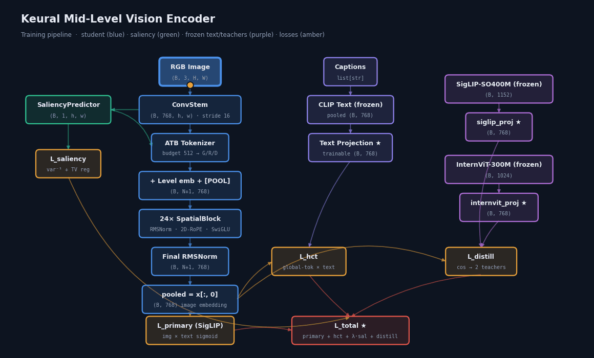
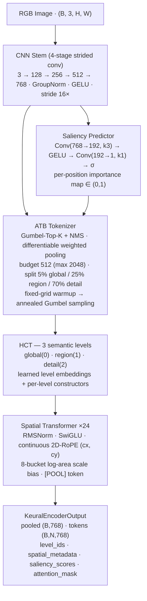

<div align="center">

# Keural Mid-Level Vision Encoder

**183.5M params · Adaptive Token Budget · Hierarchical Concept Tokens · Continuous 2D-RoPE · Dual-Teacher Distillation**

*Built from scratch by MKD Co., Ltd. — not a fine-tuned CLIP variant.*


<br/>

[**🤗 Model**](https://huggingface.co/mkd-hika/keural-vision-encoder-mid) ·
[**🎬 Interactive Pipeline Diagram**](https://huggingface.co/spaces/mkd-hika/keural-vision-encoder-diagram) ·
[**📐 Technical Spec**](PIPELINE_TECHNICAL_SPEC.md) ·
[**🔍 Architecture Audit**](ARCHITECTURE_AUDIT.md)

<br/>



</div>

---

## Overview

Keural Mid is the second stage of the Keural Vision Encoder roadmap, scaling from the 24.7M PoC to a 183.5M production-grade encoder. It replaces fixed patch tokenization with **Adaptive Token Budget (ATB)** — a content-aware, differentiable token selection mechanism — and introduces **Hierarchical Concept Tokenization (HCT)** to give the transformer explicit semantic-level signals per token.

| | PoC | **Mid (this repo)** | Large (planned) |
|---|---|---|---|
| Parameters | 24.7M | **183.5M** | ~1.1B |
| embed_dim | 512 | **768** | 1280 |
| Transformer depth | 12 | **24** | 40 |
| Token budget | 256 | **512 (max 2048)** | 1024 (max 4096) |
| Hardware | 1× RTX 5090 | **2× H200 141GB** | 64× H100 |
| Text encoder | MiniLM-L6-v2 | **CLIP ViT-L/14** | CLIP ViT-L/14 |
| Status | ✅ Complete | 🔄 Training | 📅 Planned |

---

## Architecture



> 🎬 **Animated versions:** the GIF above, or the [interactive diagram](https://huggingface.co/spaces/mkd-hika/keural-vision-encoder-diagram) (flowing tensors + compute sweep, pure SVG/JS).

### Output contract

| Field | Shape | Description |
|---|---|---|
| `pooled` | `B × 768` | Global image embedding (`[POOL]` token) |
| `tokens` | `B × N × 768` | Per-token features (`N` = allocated budget) |
| `level_ids` | `B × N` | `0`=global · `1`=region · `2`=detail |
| `spatial_metadata` | `B × N × 4` | `(cx, cy, scale_w, scale_h)` ∈ [0, 1] |
| `saliency_scores` | `B × N` | Per-token importance |
| `attention_mask` | `B × N` | Valid-token mask |

---

## Key Design Decisions

### Adaptive Token Budget (ATB)
Unlike CLIP/SigLIP which always produce a fixed N tokens, ATB selects tokens based on saliency at runtime. The budget split (5/25/70) ensures global scene context is always represented while dedicating most capacity to fine-grained detail. Gumbel-Top-K with a straight-through estimator keeps selection differentiable; a fixed-grid warmup precedes annealed adaptive sampling.

### Hierarchical Concept Tokenization (HCT)
Every token carries an explicit semantic level `{0=global, 1=region, 2=detail}`. Each level has its own learnable embedding and token constructor, giving the transformer structural information about what each token represents.

### 2D-RoPE with Continuous Coordinates
Position encoding uses the actual `(cx, cy)` spatial coordinates of each token, not a fixed grid — tokens at different resolutions or crop positions are always correctly positioned relative to each other.

### Knowledge Distillation
Two frozen teachers guide training without requiring their proprietary datasets:
- `google/siglip-so400m-patch14-384` (1152-dim → projected to 768)
- `OpenGVLab/InternViT-300M-448px` (1024-dim → projected to 768, bfloat16, auto-resized to 448×448)

### Distributed-Correct Contrastive Training
Image/text embeddings are **all-gathered across GPUs with gradient preservation** (`training/distributed.py`), so the SigLIP negative pool scales with world size. Loss-side parameters (learnable temperature/bias, text & teacher projections) are broadcast at startup and grad-synced every step, and are **persisted in an `alignment_state.pt` sidecar** next to each checkpoint so evaluation reproduces the exact training embedding space.

---

## Repository Structure

```
mid/
├── architecture/
│   ├── encoder.py               # KeuralVisionEncoder — main model
│   └── spatial/
│       ├── block.py             # SpatialBlock (RMSNorm, SwiGLU, 2D-RoPE, scale bias)
│       └── rope_2d.py           # Continuous 2D rotary position encoding
├── tokenizer/
│   ├── stem.py                  # CNN stem (4-stage strided conv)
│   ├── saliency.py              # Saliency predictor (2-conv head)
│   ├── atb_tokenizer.py         # ATB orchestrator: budget split + curriculum
│   ├── region_sampler.py        # Gumbel-Top-K + NMS + straight-through sampling
│   └── token_constructor.py     # Global cross-attention + region/detail constructors
├── training/
│   ├── losses.py                # SigLIP + HCT + saliency + distillation loss
│   ├── distillation.py          # Frozen teacher wrappers (SigLIP, InternViT)
│   └── distributed.py           # Gradient-preserving all_gather · rank sync helpers
├── alignment/
│   ├── hf_wrapper.py            # HuggingFace PreTrainedModel wrapper
│   └── output_contract.py       # KeuralEncoderOutput dataclass
├── data/
│   └── datasets.py              # WebDataset-tar datasets · BucketedSampler · FrozenTextEncoder
├── scripts/
│   ├── train_mid.py             # DDP training loop (NCCL) + alignment checkpointing
│   ├── evaluate.py              # ImageNet zero-shot · Flickr30k retrieval · CIFAR-100 probe
│   ├── viz_saliency.py          # Saliency-map visualization for any checkpoint
│   └── smoke_test_mid.py        # 5-step sanity check (183.5M params)
├── configs/
│   ├── keural_mid_2xh200.yaml   # Primary training config (2× H200)
│   └── keural_mid_smoke.yaml    # Smoke test config (synthetic data)
├── keural_mid_config.py         # Typed config dataclasses (YAML → Python)
├── PIPELINE_TECHNICAL_SPEC.md   # Full reverse-engineered technical specification
├── ARCHITECTURE_AUDIT.md        # Production audit: findings + severity + repair plan
└── pipeline_diagram.html        # Self-contained animated pipeline diagram
```

---

## Quickstart

### Install
```bash
pip install -r requirements.txt
```

### Smoke test (no data, no teachers, ~1 min)
```bash
python scripts/smoke_test_mid.py
# Expected: ALL 5 STEPS PASSED. Parameters: 183.5M
```

### Train — 2× H200 (primary)
```bash
export PYTORCH_CUDA_ALLOC_CONF=expandable_segments:True
torchrun --nproc_per_node=2 scripts/train_mid.py \
    --config configs/keural_mid_2xh200.yaml \
    --output-dir outputs/run \
    --max-samples 20000000
```
Effective batch `768 × 2 accum × 2 GPUs = 3072` · 18K optimizer steps · ~5–6 days.
Checkpoints include `alignment_state.pt` (text projection, logit scale/bias, teacher projections) — required for faithful evaluation and resume.

### Evaluate a checkpoint
```bash
python scripts/evaluate.py \
    --checkpoint outputs/run/checkpoint-10000 \
    --benchmarks imagenet flickr30k cifar100
```
Text embeddings are passed through the **trained text projection** loaded from `alignment_state.pt`, so evaluation runs in the same embedding space as training. Legacy checkpoints without the sidecar trigger an explicit warning.

### Visualize saliency maps
```bash
CUDA_VISIBLE_DEVICES="" python scripts/viz_saliency.py \
    --checkpoint outputs/run/checkpoint-4000 \
    --images path/to/images --out outputs/saliency_test --size 384
```
Renders `original | heatmap | overlay` panels per image (CPU-only — safe to run beside training).

---

## Loss Function

```
L_total = L_SigLIP + λ_hct·L_HCT + λ_sal·β_sal·L_saliency + L_distill
```

| Component | Formula | Effective weight |
|---|---|---|
| `L_SigLIP` | Sigmoid contrastive over all-gathered image↔text pairs | 1.0 |
| `L_HCT` | Same sigmoid loss on mean-pooled **global-level** tokens | λ_hct = 1.0 |
| `L_saliency` | Anti-collapse `1/(var(S)+ε)` + total-variation smoothness | λ_sal·β_sal = 0.0025 |
| `L_distill` | `mean(1 − cos)` to SigLIP + InternViT teachers | 0.25 each |

---

## Dataset

**Stage 1** (current): 20M curated pairs from DataComp-1B Medium, ~18K optimizer steps.
**Stage 2** (planned): resume from Stage 1, add COYO-700M Filtered (~32M pairs) for ~52M combined.

---

## Documentation

| Doc | Contents |
|---|---|
| [`PIPELINE_TECHNICAL_SPEC.md`](PIPELINE_TECHNICAL_SPEC.md) | Complete module-by-module spec: shapes, equations, execution timeline |
| [`ARCHITECTURE_AUDIT.md`](ARCHITECTURE_AUDIT.md) | Full correctness audit with severity ranking and repair plan |
| [`pipeline_diagram.html`](pipeline_diagram.html) | Self-contained animated block diagram (open in any browser) |
| [🤗 Model card](https://huggingface.co/mkd-hika/keural-vision-encoder-mid) | Usage, output contract, teacher table, roadmap |

---

## License

Copyright © 2026 MKD Co., Ltd. All Rights Reserved. · Contact: sales@mkd.kr
