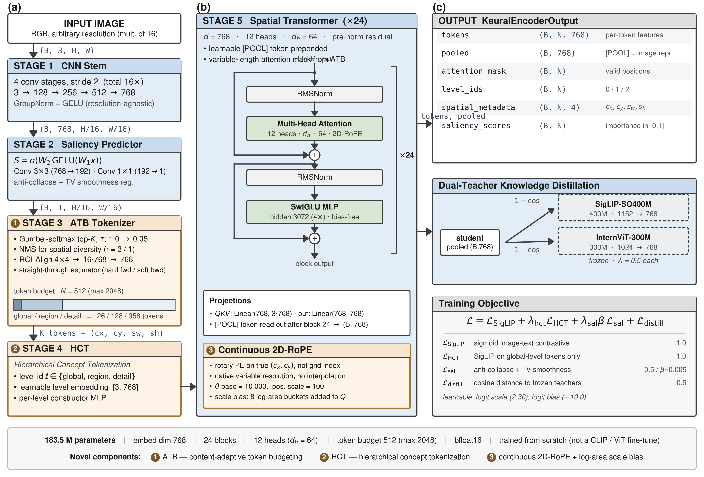
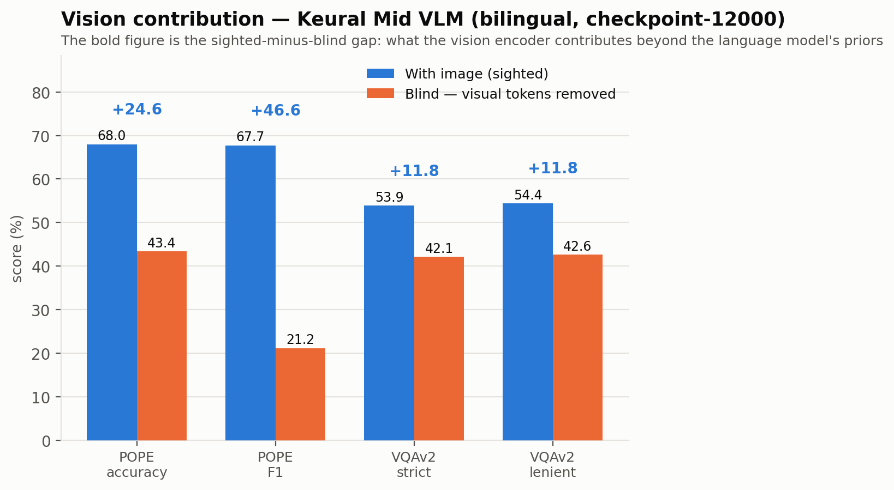
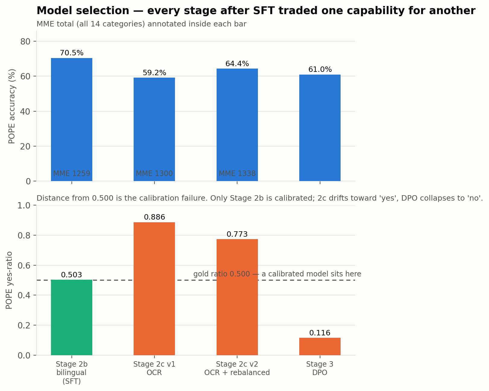

<div align="center">


# Keural Mid-Level Vision Encoder

**183.6M params · Adaptive Token Budget · Hierarchical Concept Tokens · Continuous 2D-RoPE · Dual-Teacher Distillation**

*Built from scratch by MKD Co., Ltd. — not a fine-tuned CLIP variant.*


<br/>

[**🤗 Encoder**](https://huggingface.co/mkd-hika/keural-vision-encoder-mid) ·
[**🤗 VLM (EN/KO)**](https://huggingface.co/mkd-hika/keural-mid-vlm-bilingual) ·
[**🎬 Interactive Pipeline Diagram**](https://huggingface.co/spaces/mkd-hika/keural-vision-encoder-diagram) ·
[**📐 Technical Spec**](docs/PIPELINE_TECHNICAL_SPEC.md) ·
[**🔍 Architecture Audit**](docs/ARCHITECTURE_AUDIT.md)

<br/>



</div>

---

## Overview

Keural Mid is the second stage of the Keural Vision Encoder roadmap, scaling from the 24.7M PoC to a 183.5M production-grade encoder. It replaces fixed patch tokenization with **Adaptive Token Budget (ATB)** — a content-aware, differentiable token selection mechanism — and introduces **Hierarchical Concept Tokenization (HCT)** to give the transformer explicit semantic-level signals per token.

| | PoC | **Mid (this repo)** | Large (planned) |
|---|---|---|---|
| Parameters | 24.7M | **183.5M** | ~1.1B |
| embed_dim | 512 | **768** | 1280 |
| Transformer depth | 12 | **24** | 40 |
| Token budget | 256 | **512 (max 2048)** | 1024 (max 4096) |
| Hardware | 1× RTX 5090 | **2× H200 141GB** | 64× H100 |
| Text encoder | MiniLM-L6-v2 | **CLIP ViT-L/14** | CLIP ViT-L/14 |
| Status | ✅ Complete | ✅ **Complete** (18K steps) | 📅 Planned |

---

## Results

### Stage 1 — vision encoder

| Benchmark | Result |
|---|---|
| ImageNet zero-shot Top-1 / Top-5 | 37.2% / 66.8% |
| Flickr30K image→text R@1 / R@5 / R@10 | 42.9% / 72.7% / 80.6% |
| Flickr30K text→image R@1 / R@5 / R@10 | 42.2% / 70.0% / 79.4% |
| CIFAR-100 linear probe Top-1 | 75.0% |

Zero-shot accuracy measures image–text *alignment*. For downstream use the
CIFAR-100 linear probe is the better indicator of representation quality, because
a trained projector relearns the alignment from scratch — which the Stage 2
results below bear out.

### Stage 2 — vision-language model

The encoder is **frozen** inside the VLM; only a projector (8.9M) and LoRA
adapters (5.0M) train on top of Qwen2.5-7B-Instruct. A VLM can score respectably
while barely using the image, so every benchmark is run **twice** — once
normally, once with the visual tokens removed and everything else held constant.
**The difference is what the encoder contributes**, and it is the only figure a
language model cannot produce on its own.

| Benchmark | With image | Blind | **Encoder contributes** |
|---|---|---|---|
| POPE accuracy (n=2,000) | **70.50%** | 44.55% | **+25.95** |
| POPE F1 (n=2,000) | **70.59%** | 23.46% | **+47.13** |
| VQAv2 strict (n=5,000) | **53.04%** | 39.83% | **+13.21** |
| MME total, 14 categories (n=2,374) | **1258.9** | 812.0 | **+446.9** |
| MMBench (n=4,377) | 60.20% | — | — |
| Held-out perplexity, Korean / English | 2.15 / 2.99 | — | — |

POPE yes-ratio is **0.492 against a gold 0.500**, so the model discriminates on
object-existence questions rather than defaulting to one answer — accuracy alone
is not interpretable without that check.



### Training stages

| Stage | What it does | Data | Steps | Outcome |
|---|---|---|---|---|
| 1 | Contrastive pre-training + dual-teacher distillation | 20M pairs | 18,000 | ✅ encoder |
| 2a | Projector alignment on captions | LLaVA-Pretrain 557K | 5,000 | ✅ ppl 31.81 → 17.30 |
| 2b | Supervised instruction tuning (SFT), English | LLaVA-Instruct 157K | 8,000 | ✅ ppl 3.22 → 2.90 |
| 2b | SFT, bilingual EN+KO | Merged 603K | 12,000 | ✅ **recommended model** |
| 2c | OCR specialization (two runs) | TextVQA 30K + replay | 4,000 / 2,000 | ⚠️ trade-off |
| 3 | Direct Preference Optimization | RLHF-V 5.5K pairs | 2,000 | ❌ negative result |

Every stage after SFT traded one capability for another. Stage 2c raised MME
(1258.9 → 1337.8) and MME OCR (110.0 → 137.5) but drifted toward answering
"yes" on binary questions. Stage 3 DPO optimized its own objective successfully
(held-out reward accuracy 0.890) but collapsed toward answering "no"
(POPE yes-ratio 0.503 → 0.116). **Stage 2b bilingual is the recommended
checkpoint** — it is the only calibrated one.



Full analysis, including the diagnosis of each failure, is in the Technical
Documentation Report (distributed separately — `docs/reports/` is not tracked in
this repository). Architectural detail is in
[PIPELINE_TECHNICAL_SPEC.md](docs/PIPELINE_TECHNICAL_SPEC.md) and
[ARCHITECTURE.md](docs/ARCHITECTURE.md); benchmark methodology in
[BENCHMARK_COMPARISON.md](docs/BENCHMARK_COMPARISON.md).

---

## Architecture


> The figure at the top of this README is the full specification: **(a)** tokenizer stack, **(b)** spatial transformer block and continuous 2D-RoPE, **(c)** output contract, dual-teacher distillation and training objective. An interactive version is available in [`assets/pipeline_diagram.html`](assets/pipeline_diagram.html) (self-contained SVG/JS — open in any browser).

### Output contract

| Field | Shape | Description |
|---|---|---|
| `pooled` | `B × 768` | Global image embedding (`[POOL]` token) |
| `tokens` | `B × N × 768` | Per-token features (`N` = allocated budget) |
| `level_ids` | `B × N` | `0`=global · `1`=region · `2`=detail |
| `spatial_metadata` | `B × N × 4` | `(cx, cy, scale_w, scale_h)` ∈ [0, 1] |
| `saliency_scores` | `B × N` | Per-token importance |
| `attention_mask` | `B × N` | Valid-token mask |

---

## Key Design Decisions

### Adaptive Token Budget (ATB)
Unlike CLIP/SigLIP which always produce a fixed N tokens, ATB selects tokens based on saliency at runtime. The budget split (5/25/70) ensures global scene context is always represented while dedicating most capacity to fine-grained detail. Gumbel-Top-K with a straight-through estimator keeps selection differentiable; a fixed-grid warmup precedes annealed adaptive sampling.

### Hierarchical Concept Tokenization (HCT)
Every token carries an explicit semantic level `{0=global, 1=region, 2=detail}`. Each level has its own learnable embedding and token constructor, giving the transformer structural information about what each token represents.

### 2D-RoPE with Continuous Coordinates
Position encoding uses the actual `(cx, cy)` spatial coordinates of each token, not a fixed grid — tokens at different resolutions or crop positions are always correctly positioned relative to each other.

### Knowledge Distillation
Two frozen teachers guide training without requiring their proprietary datasets:
- `google/siglip-so400m-patch14-384` (1152-dim → projected to 768)
- `OpenGVLab/InternViT-300M-448px` (1024-dim → projected to 768, bfloat16, auto-resized to 448×448)

### Distributed-Correct Contrastive Training
Image/text embeddings are **all-gathered across GPUs with gradient preservation** (`training/distributed.py`), so the SigLIP negative pool scales with world size. Loss-side parameters (learnable temperature/bias, text & teacher projections) are broadcast at startup and grad-synced every step, and are **persisted in an `alignment_state.pt` sidecar** next to each checkpoint so evaluation reproduces the exact training embedding space.

---

## Repository Structure

<pre>
mid/
├── <a href="architecture/">architecture/</a>
│   ├── <a href="architecture/encoder.py">encoder.py</a>               # KeuralVisionEncoder — main model
│   └── <a href="architecture/spatial/">spatial/</a>
│       ├── <a href="architecture/spatial/block.py">block.py</a>             # SpatialBlock (RMSNorm, SwiGLU, 2D-RoPE, scale bias)
│       └── <a href="architecture/spatial/rope_2d.py">rope_2d.py</a>           # Continuous 2D rotary position encoding
├── <a href="tokenizer/">tokenizer/</a>
│   ├── <a href="tokenizer/stem.py">stem.py</a>                  # CNN stem (4-stage strided conv)
│   ├── <a href="tokenizer/saliency.py">saliency.py</a>              # Saliency predictor (2-conv head)
│   ├── <a href="tokenizer/atb_tokenizer.py">atb_tokenizer.py</a>         # ATB orchestrator: budget split + curriculum
│   ├── <a href="tokenizer/region_sampler.py">region_sampler.py</a>        # Gumbel-Top-K + NMS + straight-through sampling
│   └── <a href="tokenizer/token_constructor.py">token_constructor.py</a>     # Global cross-attention + region/detail constructors
├── <a href="training/">training/</a>
│   ├── <a href="training/losses.py">losses.py</a>                # SigLIP + HCT + saliency + distillation loss
│   ├── <a href="training/distillation.py">distillation.py</a>          # Frozen teacher wrappers (SigLIP, InternViT)
│   └── <a href="training/distributed.py">distributed.py</a>           # Gradient-preserving all_gather · rank sync helpers
├── <a href="alignment/">alignment/</a>
│   ├── <a href="alignment/hf_wrapper.py">hf_wrapper.py</a>            # HuggingFace PreTrainedModel wrapper
│   ├── <a href="alignment/output_contract.py">output_contract.py</a>       # KeuralEncoderOutput dataclass
│   ├── <a href="alignment/projectors.py">projectors.py</a>            # Simple / LevelAware / Metadata projectors → LLM
│   └── <a href="alignment/vlm_helpers.py">vlm_helpers.py</a>           # build_vlm_inputs (vision+text splice)
├── <a href="data/">data/</a>
│   ├── <a href="data/datasets.py">datasets.py</a>              # WebDataset-tar datasets · BucketedSampler · FrozenTextEncoder
│   └── <a href="data/vlm_dataset.py">vlm_dataset.py</a>           # Stage 2 VLM streams (caption + LLaVA instruction)
├── <a href="scripts/">scripts/</a>
│   ├── <a href="scripts/train_mid.py">train_mid.py</a>             # DDP training loop (NCCL) + alignment checkpointing
│   ├── <a href="scripts/evaluate.py">evaluate.py</a>              # ImageNet zero-shot · Flickr30k retrieval · CIFAR-100 probe
│   ├── <a href="scripts/viz_saliency.py">viz_saliency.py</a>          # Saliency-map visualization for any checkpoint
│   ├── <a href="scripts/smoke_test_mid.py">smoke_test_mid.py</a>        # 5-step sanity check (183.5M params)
│   ├── <a href="scripts/auto_eval_on_finish.sh">auto_eval_on_finish.sh</a>   # Waits for training to end, then evaluates
│   ├── <a href="scripts/train_projector.py">train_projector.py</a>       # Stage 2: projector/LoRA alignment to an LLM
│   ├── <a href="scripts/run_stage2a_caption.sh">run_stage2a_caption.sh</a>   # Stage 2a launcher — projector warm-up
│   ├── <a href="scripts/run_stage2b_instruct.sh">run_stage2b_instruct.sh</a>  # Stage 2b launcher — instruction tuning (EN)
│   ├── <a href="scripts/run_stage2b_bilingual.sh">run_stage2b_bilingual.sh</a> # Stage 2b launcher — instruction tuning (EN+KO)
│   ├── <a href="scripts/prepare_llava_jsonl.py">prepare_llava_jsonl.py</a>   # LLaVA JSON -> JSONL, drops missing-image records
│   ├── <a href="scripts/run_stage2c_v2.sh">run_stage2c_v2.sh</a>        # Stage 2c launcher — OCR, calibration-corrected
│   ├── <a href="scripts/train_dpo_vlm.py">train_dpo_vlm.py</a>         # Stage 3: DPO (precomputed reference policy)
│   ├── <a href="scripts/prepare_dpo_data.py">prepare_dpo_data.py</a>      # RLHF-V preference pairs -> JSONL
│   ├── <a href="scripts/prepare_ocr_data_v2.py">prepare_ocr_data_v2.py</a>   # OCR mix with stratified yes/no replay
│   ├── <a href="scripts/build_bilingual_mix_v2.py">build_bilingual_mix_v2.py</a> # EN/KO mix + English short-answer VQA
│   ├── <a href="scripts/vlm_studio.py">vlm_studio.py</a>            # Streamlit GUI — chat, compare, saliency, prompt lab
│   ├── <a href="scripts/demo_video.py">demo_video.py</a>            # Video understanding probe (frame aggregation)
│   ├── <a href="scripts/gpu_queue.sh">gpu_queue.sh</a>             # Sequential job queue so the GPU never idles
│   ├── <a href="scripts/run_eval_2b.sh">run_eval_2b.sh</a>           # POPE + VQAv2 sighted/blind in one pass
│   ├── <a href="scripts/publish_to_hf.py">publish_to_hf.py</a>         # Publish encoder + VLM to Hugging Face
│   ├── <a href="scripts/demo_vlm.py">demo_vlm.py</a>              # VLM inference / interactive chat about an image
│   └── <a href="scripts/eval_vlm.py">eval_vlm.py</a>              # VLM benchmarks: POPE / VQAv2 / MME / MMBench / held-out
├── <a href="configs/">configs/</a>
│   ├── <a href="configs/keural_mid_2xh200.yaml">keural_mid_2xh200.yaml</a>   # Primary training config (2× H200)
│   ├── <a href="configs/keural_mid_smoke.yaml">keural_mid_smoke.yaml</a>    # Smoke test config (synthetic data)
│   └── <a href="configs/keural_mid_architecture.json">keural_mid_architecture.json</a>  # Machine-readable architecture spec
├── <a href="docs/">docs/</a>
│   ├── <a href="docs/PIPELINE_TECHNICAL_SPEC.md">PIPELINE_TECHNICAL_SPEC.md</a>  # Full reverse-engineered technical specification
│   ├── <a href="docs/ARCHITECTURE.md">ARCHITECTURE.md</a>            # Architecture reference
│   ├── <a href="docs/ARCHITECTURE_AUDIT.md">ARCHITECTURE_AUDIT.md</a>      # Production audit: findings + severity + repair plan
│   ├── <a href="docs/BENCHMARK_COMPARISON.md">BENCHMARK_COMPARISON.md</a>    # Evaluation results vs. teachers and peers
│   ├── <a href="docs/KEURAL_TINY_VS_MID.md">KEURAL_TINY_VS_MID.md</a>      # PoC (24.7M) vs Mid (183.5M) comparison
│   ├── <a href="docs/DATASET_INFO.md">DATASET_INFO.md</a>            # Dataset composition and provenance
│   ├── <a href="docs/DATASET_DOWNLOAD.md">DATASET_DOWNLOAD.md</a>        # Dataset acquisition instructions
│   └── <a href="docs/figures/">figures/</a>                  # Benchmark charts, loss curves, saliency figures
├── <a href="assets/">assets/</a>
│   ├── <a href="assets/pipeline_diagram.html">pipeline_diagram.html</a>      # Self-contained animated pipeline diagram
│   ├── <a href="assets/keural_mid_architecture.png">keural_mid_architecture.png</a>  # Full architecture specification figure
│   └── <a href="assets/keural-logo.svg">keural-logo.svg</a>            # Brand mark
├── <a href="keural_mid_config.py">keural_mid_config.py</a>         # Typed config dataclasses (YAML → Python)
├── <a href="requirements.txt">requirements.txt</a>
└── <a href="setup_venv.sh">setup_venv.sh</a>
</pre>

---

## Quickstart

### Install
```bash
pip install -r requirements.txt
```

### Smoke test (no data, no teachers, ~1 min)
```bash
python scripts/smoke_test_mid.py
# Expected: ALL 5 STEPS PASSED. Parameters: 183.5M
```

### Train — 2× H200 (primary)
```bash
export PYTORCH_CUDA_ALLOC_CONF=expandable_segments:True
torchrun --nproc_per_node=2 scripts/train_mid.py \
    --config configs/keural_mid_2xh200.yaml \
    --output-dir outputs/run \
    --max-samples 20000000
```
Effective batch `768 × 2 accum × 2 GPUs = 3072` · 18K optimizer steps · ~5–6 days.
Checkpoints include `alignment_state.pt` (text projection, logit scale/bias, teacher projections) — required for faithful evaluation and resume.

### Evaluate a checkpoint
```bash
python scripts/evaluate.py \
    --checkpoint outputs/run/checkpoint-10000 \
    --benchmarks imagenet flickr30k cifar100
```
Text embeddings are passed through the **trained text projection** loaded from `alignment_state.pt`, so evaluation runs in the same embedding space as training. Legacy checkpoints without the sidecar trigger an explicit warning.

### Visualize saliency maps
```bash
CUDA_VISIBLE_DEVICES="" python scripts/viz_saliency.py \
    --checkpoint outputs/run/checkpoint-4000 \
    --images path/to/images --out outputs/saliency_test --size 384
```
Renders `original | heatmap | overlay` panels per image (CPU-only — safe to run beside training).

---

## Loss Function

```
L_total = L_SigLIP + λ_hct·L_HCT + λ_sal·β_sal·L_saliency + L_distill
```

| Component | Formula | Effective weight |
|---|---|---|
| `L_SigLIP` | Sigmoid contrastive over all-gathered image↔text pairs | 1.0 |
| `L_HCT` | Same sigmoid loss on mean-pooled **global-level** tokens | λ_hct = 1.0 |
| `L_saliency` | Anti-collapse `1/(var(S)+ε)` + total-variation smoothness | λ_sal·β_sal = 0.0025 |
| `L_distill` | `mean(1 − cos)` to SigLIP + InternViT teachers | 0.25 each |

---

## Dataset

**Stage 1** (current): 20M curated pairs from DataComp-1B Medium, ~18K optimizer steps.
**Stage 2** (planned): resume from Stage 1, add COYO-700M Filtered (~32M pairs) for ~52M combined.

---

## Documentation

- **Technical Documentation Report** — full architecture, methodology, mathematics and results for Stages 1–3 (distributed separately; `docs/reports/` is untracked)
- [**VLM model card**](docs/HF_VLM_MODEL_CARD.md) — the bilingual vision-language model
- [**Training guide**](docs/TRAINING_GUIDE.md) — how to reproduce each stage
| Doc | Contents |
|---|---|
| [`PIPELINE_TECHNICAL_SPEC.md`](docs/PIPELINE_TECHNICAL_SPEC.md) | Complete module-by-module spec: shapes, equations, execution timeline |
| [`TRAINING_GUIDE.md`](docs/TRAINING_GUIDE.md) | Step-by-step runbook: Stage 1 → Stage 2a → Stage 2b, monitoring, troubleshooting |
| [`OCR_ROADMAP.md`](docs/OCR_ROADMAP.md) | Scoping for document/OCR support: measured constraints and options |
| [`ARCHITECTURE_AUDIT.md`](docs/ARCHITECTURE_AUDIT.md) | Full correctness audit with severity ranking and repair plan |
| [`pipeline_diagram.html`](assets/pipeline_diagram.html) | Self-contained animated block diagram (open in any browser) |
| [🤗 Model card](https://huggingface.co/mkd-hika/keural-vision-encoder-mid) | Usage, output contract, teacher table, roadmap |

---

## License

Copyright © 2026 MKD Co., Ltd. All Rights Reserved. · Contact: sales@mkd.kr
